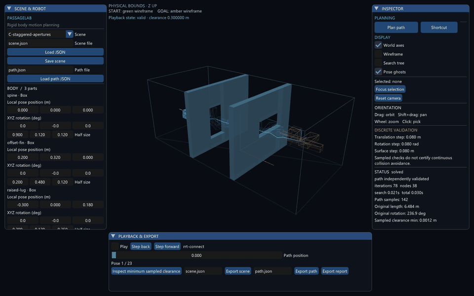

# PassageLab

**English** · [简体中文](README.zh-CN.md) · [中文演示与操作指南](docs/demo.zh-CN.md)

**An interactive C++20 tool for planning and inspecting rigid-body motion through constrained 3D environments.**

A long bar, an L-shaped body, and an asymmetric assembly move through obstacles using translation and rotation. PassageLab computes the motion, checks every path segment at an explicit resolution, and lets you inspect the resulting poses and clearance.

> Version 0.2.0: design phases P0–P6 implemented and verified on Windows x64. 40 CTest cases, 75 desktop input checks, three solved demos with finer path rechecks, fresh-source rebuild and fixed-seed experiments. See [verification status](docs/implementation-status.md) and the [Chinese acceptance report](docs/acceptance-0.2.0.zh-CN.md). P7 is optional future work. [Download v0.2.0](https://github.com/CG-Yici/PassageLab/releases/tag/v0.2.0).



## What the project demonstrates

- A self-written bidirectional **RRT-Connect** planner in SE(3), with uniform orientation sampling, operation budgets and cancellation.
- Custom rigid transforms, analytic sphere queries, **OBB separating-axis collision detection**, static obstacle **BVH**, and discrete motion validation.
- Box-feature distances and nearest points, with FCL distance audits and independent collision comparisons.
- A GLFW / OpenGL / Dear ImGui desktop application, with pose editing, playback, search trees, collision and clearance inspection.
- Validated shortcut optimization, immutable scene snapshots, stale-result rejection, versioned JSON and SHA-256 input fingerprints.
- A headless CLI and an OMPL comparison adapter for reproducible experiments.
- Matched SE(3) / fixed-height, fixed-tilt planar planning, with the same state and motion checks.

The planner implements an established algorithm. Eigen supplies linear algebra, FCL supplies independent geometry comparisons, and OMPL supplies a separate planner. A tested box-specific feature distance handles cases where FCL's GJK distance varied with argument order. See [architecture](docs/architecture.md) and [algorithm notes](docs/algorithms.md).

## Run the portable release

Download `PassageLab-0.2.0-windows-x64.zip` from the [v0.2.0 release](https://github.com/CG-Yici/PassageLab/releases/tag/v0.2.0), extract it, and run **Start PassageLab.cmd**. Windows x64 and an OpenGL 3.3 driver are required. The release includes checksums, package verification and a demo video. See [release notes](docs/releases/v0.2.0.md) for provenance and tested scope.

## Build on Windows

Requirements: Windows 10/11 x64, Git, Visual Studio 2022 **Desktop development with C++**, Windows SDK and Visual Studio's CMake tools. OpenGL 3.3 is required for the viewer. Only Windows is currently targeted.

```powershell
git clone https://github.com/CG-Yici/PassageLab.git
cd PassageLab
powershell -ExecutionPolicy Bypass -File tools/build.ps1
./build/windows/Release/passagelab_desktop.exe
```

The build script checks out the vcpkg baseline in `vcpkg.json`, installs dependencies, builds Release and runs CTest. The first dependency build can take a while. It temporarily maps a free drive letter for dependency builds to avoid Windows RC/Ninja issues with Unicode or spaced paths, and releases the mapping afterward. No administrator privileges are required.

For this migrated workspace, run from `passagelab-codex/`. The inherited `build/windows` cache names the previous source location; leave it as historical output and use a fresh build directory with the already installed local dependencies:

```powershell
powershell -ExecutionPolicy Bypass -File tools/build.ps1 -UseInstalledDependencies -BuildDirectory build/worktree
./build/worktree/Release/passagelab_desktop.exe
powershell -ExecutionPolicy Bypass -File tools/verify.ps1 -BuildDirectory build/worktree -OutputDirectory results/new-acceptance
powershell -ExecutionPolicy Bypass -File tools/package.ps1 -BuildDirectory build/worktree
```

`verify.ps1` checks references, fixed-seed planning, original and optimized paths at 0.02 resolution, the exhausted-budget case, BVH agreement, desktop smoke/self-tests and 25 input-driven operations per scene. It captures real rendered frames and measures rendering, cancellation and memory against reference-host targets. `-SkipDesktop` supports headless verification and records that omission. Verification output directories must be new; packaging refuses to replace an existing package.

`tools/clean_build.ps1` copies source into a fresh local directory and rebuilds/tests it using the pinned dependency installation. `tools/verify_package.ps1` extracts the ZIP into a fresh directory, verifies binary hashes and reruns CLI/desktop checks with a system-only PATH. The portable package includes app-local Visual C++ runtime DLLs; extract it and run **Start PassageLab.cmd**.

## Headless examples

```powershell
$cli = './build/windows/Release/passagelab_cli.exe'
& $cli generate-scenes --out assets/scenes
& $cli plan --demo 0 --seed 42 --seconds 0 --out results/demo-a
& $cli validate-path --scene results/demo-a/scene.json --path results/demo-a/path.json
& $cli plan --demo 1 --planner ompl --seed 42 --out results/ompl-b
& $cli benchmark --demo 2 --runs 30 --seed 1000 --seconds 5 --out results/experiment-c
```

`--seconds 0` disables the wall-clock deadline; operation and query limits still apply. The saved scene includes configuration overrides, so revalidate against the exported `scene.json`. A `plan` exit code of 0 means solved and verified, 2 means a recorded unsolved result, and 1 means an input or execution error. A timeout does not prove infeasibility.

Each plan needs a new output directory: existing scene/path/report files are preserved and produce an error instead of being mixed with another run. Unknown options, malformed numbers and unknown planner names are rejected. Reports include a source SHA-256 and tracked-worktree dirty flag in addition to the Git commit.

`--motion-space planar-xy` restricts motion to XY translation and world-Z yaw relative to the start orientation. A goal with another height or tilt is invalid. Use compatible endpoints for a meaningful SE(3)/planar comparison; the geometry-variant runner creates and records such a paired case explicitly.

## Demonstrations

| Scene | Question | Geometry |
|---|---|---|
| A: offset passage | Why does checking only the center miss a collision? | Long bar and offset route around a column |
| B: L corner | How does a compound body turn through a corridor? | Fixed L assembly, inner corner and enclosing boundaries |
| C: staggered apertures | When does out-of-plane orientation matter? | Asymmetric three-part body, two differently shaped openings |

Reference motions are explicitly labeled `hand-constructed-reference` and are validated separately. They are not fed to the planner. All three scenes have physical bounds that constrain the entire body, preventing external bypasses. Their initial parameters are engineering demonstration cases, not measurements of real spaces.

## Validation and limits

**“Solved” means the complete path passed the declared discrete checks. It is not a continuous collision-free certificate.** Each segment samples translation, angular change and a body-surface travel bound; endpoint-only checking is insufficient. Contact and numerical uncertainty are rejected. Path modification requires revalidation. See [validation](docs/validation.md).

One rigid body, static boxes/spheres, no gravity, forces, flexible parts, robot joints, CAD import or dynamics. Geometry units are metres, angles radians, Z is up, and serialized quaternions are `[x,y,z,w]`. The metrics describe geometric paths, not real-world maneuver safety or execution speed.

## Experiments

```powershell
python tools/experiments.py --suite baseline --runs 30 --seconds 5 --out results/new-baseline
python tools/experiments.py --suite comparisons --runs 30 --seconds 5 --out results/new-comparisons
python tools/design_experiments.py --exe build/windows/Release/passagelab_cli.exe --runs 30 --seconds 1 --out results/new-geometry-experiments
```

Python is optional for running the application. The experiment runner uses the standard library; matplotlib is optional for charts. Reports retain failed runs, environment information, seeds, validation settings and query counts. Solved-only timing statistics are explicitly conditional on success. See [experiment notes](docs/experiments.md).

For the migrated build add `--exe build/worktree/Release/passagelab_cli.exe`. Current evidence is under [worktree-0.2.0](benchmarks/data/worktree-0.2.0); previous 0.1.0/0.1.1 evidence and media remain unchanged. All failed experiment outcomes are retained alongside successes.

## Project map

```text
include/passagelab/       public domain and IO interfaces
src/geometry.cpp         transforms, queries, BVH, state/motion validation
src/planning.cpp         sampling, RRT-Connect, path verification and optimization
src/ompl_adapter.cpp     OMPL comparison using shared geometry/motion checks
src/io.cpp               strict JSON, SHA-256, reports
src/scenes.cpp           parameterized demonstration construction
apps/                    command-line and desktop entrypoints
tests/                   analytical, randomized and integration regressions
assets/scenes/           frozen inputs and separately labeled references
benchmarks/              experiment definitions and selected raw evidence
tools/                   build, package and experiment scripts
```

The original [Chinese project design](docs/project-design.zh-CN.md) records intended scope. [Implementation status](docs/implementation-status.md) records actual verification. Original source: [MIT](LICENSE). Dependencies: [third-party notices](THIRD_PARTY_NOTICES.md).
