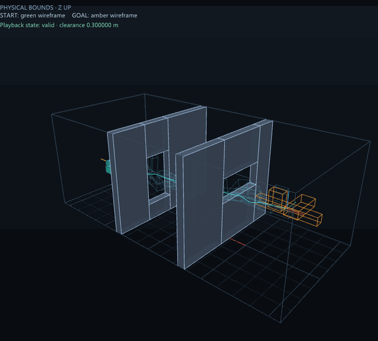
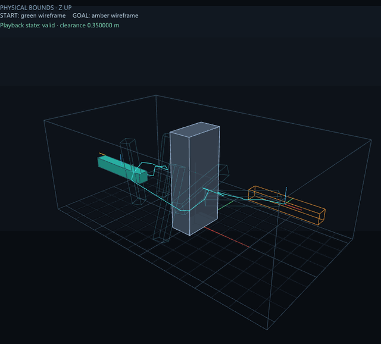
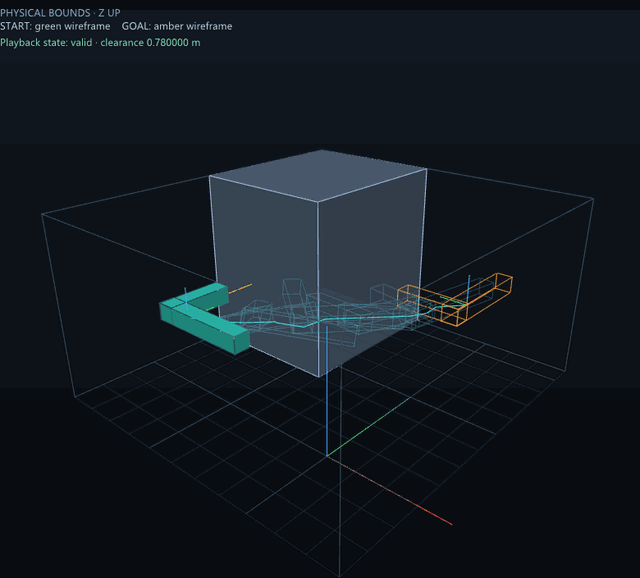
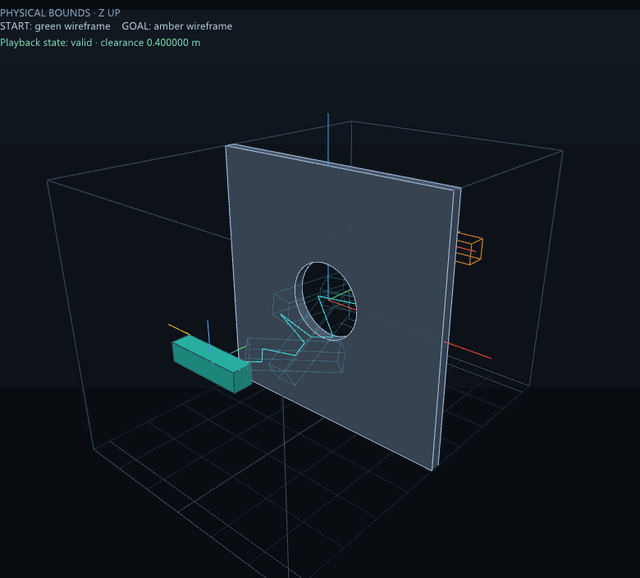

# PassageLab

**English** · [简体中文](README.zh-CN.md)

PassageLab plans how a rigid body gets through a tight 3D space, and lets you look at the result. You give it a body, some obstacles, a start pose and a goal pose. It searches for a motion that translates and rotates the body past the obstacles, checks that motion, and plays it back with the clearance at every pose.

It is written in C++20 with an OpenGL viewer, and runs on Windows x64.



## What is in it

- **Planner.** My own bidirectional RRT-Connect in SE(3). Orientations are sampled uniformly, searches have iteration, node and query budgets, and a running search can be cancelled.
- **Collision and distance.** Analytic sphere queries, a separating-axis test for oriented boxes, and exact box-to-box distance with closest points. A BVH over the obstacles keeps the number of pair tests down.
- **CAD obstacles.** A STEP file can be an obstacle. OpenCASCADE tessellates the B-rep; PassageLab welds the per-face output into one indexed mesh, checks that it is watertight, compares its volume with the B-rep, and queries it through a triangle BVH. Details in [CAD to triangle mesh](docs/cad-mesh.md).
- **Motion checking.** Each path segment is sampled by translation, by rotation and by how far the body's surface travels, so a long bar swinging through a small angle still gets enough samples.
- **Viewer.** GLFW, OpenGL 3.3 and Dear ImGui. Edit poses and sizes, pick and drag objects, scrub through a path, show the search tree, jump to the tightest pose.
- **Reproducible runs.** A command-line tool, JSON scenes and paths with SHA-256 fingerprints, fixed seeds, and an OMPL RRT-Connect that runs on the same collision checker for comparison.

Two things I did not write: the tessellation algorithm (OpenCASCADE) and the comparison planner (OMPL). FCL is used only to cross-check my box distances. That cross-check is how I found that FCL 0.7.0 returned different distances for the same two boxes depending on argument order, which is why the box distance here is my own. The story is in [algorithm notes](docs/algorithms.md).

## Scenes

| | Scene | What it shows |
|---|---|---|
|  | **A: offset passage** | A long bar has to swing around a column. The centre of the bar fits easily; the ends do not. |
|  | **B: L corner** | Two boxes joined into an L turn through a corridor as one body. |
|  | **C: staggered apertures** | A three-part body passes two openings at different heights, so it has to tilt out of plane. |
|  | **D: STEP aperture** | A 1.0 m bar goes through a 0.9 m round hole in a plate loaded from a STEP file. It only fits lengthwise. |

All recordings are frames from the viewer itself. In every scene the whole body has to stay inside the outer box, so it cannot simply go around.

## Try it

**Prebuilt.** Download `PassageLab-0.2.0-windows-x64.zip` from the [v0.2.0 release](https://github.com/CG-Yici/PassageLab/releases/tag/v0.2.0), unzip it and run `Start PassageLab.cmd`. You need Windows x64 and an OpenGL 3.3 driver. The 0.2.0 package has scenes A to C; STEP obstacles and scene D came later and need a source build.

**From source.** Install Git and Visual Studio 2022 with *Desktop development with C++*, then:

```powershell
git clone https://github.com/CG-Yici/PassageLab.git
cd PassageLab
powershell -ExecutionPolicy Bypass -File tools/build.ps1
./build/windows/Release/passagelab_desktop.exe
```

The script fetches the pinned vcpkg dependencies, builds Release and runs the tests. The first run compiles OpenCASCADE and OMPL from source and takes a good while; later runs are quick. It maps a spare drive letter during the dependency build, because some of the tools break on paths with spaces or non-ASCII characters, and removes the mapping when it finishes. Administrator rights are not needed.

In the viewer, pick a scene at the top left, press **Plan path**, wait for `STATUS solved`, then tick **Play**. To open scene D, type `assets/cad/D-step-aperture.json` into **Scene file** and press **Load JSON**. Controls are listed in [viewer notes](docs/viewer.md).

## Command line

```powershell
$cli = './build/windows/Release/passagelab_cli.exe'
& $cli plan --demo 0 --seed 42 --seconds 0 --out results/demo-a
& $cli validate-path --scene results/demo-a/scene.json --path results/demo-a/path.json
& $cli plan --demo 1 --planner ompl --seed 42 --out results/ompl-b
& $cli plan --scene assets/cad/D-step-aperture.json --seconds 0 --out results/step-aperture
& $cli cad-mesh --cad assets/cad/plate-with-hole.step --sweep --out results/plate-sweep.json
& $cli benchmark --demo 2 --runs 30 --seed 1000 --seconds 5 --out results/experiment-c
```

`plan` exits with 0 when it found and verified a path, 2 when it ran out of budget, and 1 on bad input. `--seconds 0` turns off the wall-clock limit so that only the operation budgets apply, which makes a run repeatable. Each run wants a new output folder and will not overwrite an old one.

`--motion-space planar-xy` keeps the body at its starting height and only lets it yaw. It is there to compare against full 3D motion on the same scene.

## How far to trust a result

`solved` means every segment of the path passed the sampled checks at the step size recorded in the report. It does not prove that the continuous motion is collision-free: something thinner than the step could sit between two samples. Check again at a finer step when it matters. `validate-path --step` does that, and the demo paths are rechecked at a quarter of the planning step.

Running out of budget does not mean there is no path. Touching counts as a collision. If a geometry query cannot give a definite answer, the state is rejected.

A mesh is an approximation of the CAD surface, accurate to the chosen deflection. Pick a deflection smaller than the clearance you care about.

Out of scope: several moving bodies, robot joints, forces and dynamics, deformable parts, and mesh-shaped moving bodies. Units are metres and radians, Z is up, and quaternions are stored as `[x, y, z, w]`.

## Measurements

From one Windows machine, Release build. Raw output is in [benchmarks/data](benchmarks/data).

- **Obstacle BVH.** 1,000 poses against 144 boxes: 134,830 pair tests without the BVH, 1,163 with it, and identical results.
- **Triangle BVH.** 1,000 box poses against a 12,540-triangle torus: 24.1 million triangle tests without, 239 thousand with, and identical results.
- **Tessellation.** The same torus at 0.5 mm deflection is watertight and within 0.27% of the B-rep volume. At 16 mm it is 2,592 triangles and within 1.0%.
- **Planner.** In the 0.2.0 experiments, scenes A to C solved 360 of 360 runs (30 seeds, four configurations, 5 s each). With the opening in scene C narrowed by 15%, 12 of 30 solved within 1 s.

More in [experiment notes](docs/experiments.md) and [CAD to triangle mesh](docs/cad-mesh.md).

## Tests

46 CTest cases. They compare against closed-form distances and against FCL, check that the BVH and the exhaustive search agree, check a meshed box against the analytic box, and cover the cases that are easy to get wrong: contact exactly at the tolerance, degenerate triangles, quaternion sign flips, cancelled searches, stale paths loaded against an edited scene. The viewer has its own replayed-input self-test.

```powershell
ctest --test-dir build/windows -C Release --output-on-failure
./build/windows/Release/passagelab_desktop.exe --ui-self-test
```

## Layout

```text
include/passagelab/   public headers
src/geometry.cpp      transforms, shape queries, obstacle BVH, state and motion checks
src/mesh.cpp          welding, topology checks, triangle BVH, mesh queries
src/cad.cpp           STEP reading and tessellation (the only file that includes OpenCASCADE)
src/planning.cpp      sampling, RRT-Connect, path checking, shortcutting
src/ompl_adapter.cpp  OMPL planner on the same checker
src/io.cpp            JSON, hashing, reports
apps/                 command-line tool and viewer
tests/                unit and integration tests
assets/               scenes and STEP files
benchmarks/           experiment configs and recorded results
tools/                build, packaging and recording scripts
```

## Further reading

- [Algorithm notes](docs/algorithms.md) and [architecture](docs/architecture.md)
- [CAD to triangle mesh](docs/cad-mesh.md)
- [Validation](docs/validation.md): exactly what is sampled and when a path is rejected
- [0.2.0 verification record](docs/implementation-status.md)
- [Original design document](docs/project-design.zh-CN.md) (Chinese)

PassageLab's own code is under the [MIT license](LICENSE). Dependencies keep their own licenses; see [third-party notices](THIRD_PARTY_NOTICES.md).
