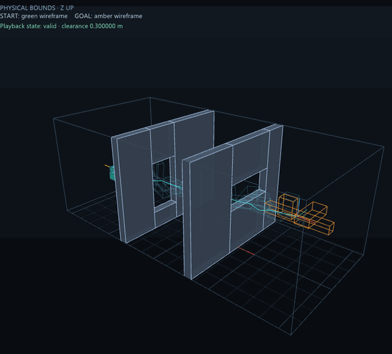
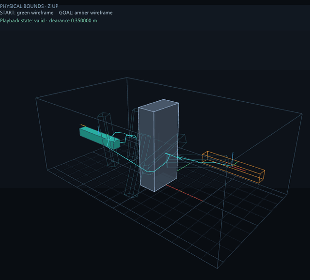
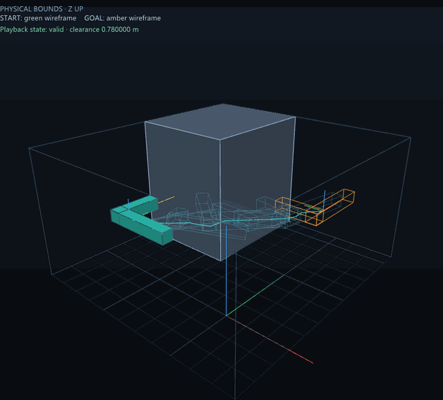
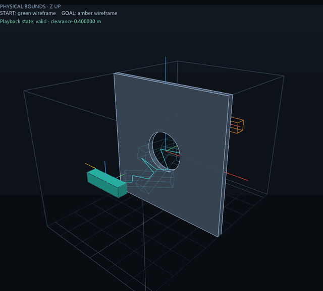

# PassageLab

[English](README.md) · **简体中文** · [演示与操作指南](docs/demo.zh-CN.md)

PassageLab 解决的问题是：一个不会变形的物体，怎样边移动边转动，穿过一个狭窄的三维空间。你给出物体、障碍物、起点和终点的位姿，它去找一条能通过的运动，检查这条运动有没有碰撞，再把过程放给你看，每个姿态离障碍物多远也一并显示。

程序用 C++20 写成，界面用 OpenGL，目前只支持 Windows x64，界面文字是英文。



## 做了哪些东西

- **路径规划**：自己实现的双向 RRT-Connect，在 SE(3) 里搜索，位置和朝向一起采样。搜索有迭代次数、节点数和查询次数的上限，也可以中途取消。
- **碰撞与距离**：球用解析公式，有向箱体用分离轴判定，箱体之间的距离和最近点是精确计算的。障碍物上建了一层 BVH，用来减少需要逐对检查的数量。
- **CAD 障碍物**：STEP 文件可以直接当障碍物用。三角化交给 OpenCASCADE；之后把各个面的结果拼成一张带索引的三角网格、合并重复顶点、检查是否封闭、和 B-rep 的体积做对比，再用三角形 BVH 做查询，这些是本项目自己写的。详见 [从 CAD 到三角网格](docs/cad-mesh.md)（英文）。
- **运动检查**：每一段路径按平移量、转角和物体表面扫过的距离三个标准取样。这样一根长杆即使只转很小的角度，也会被检查足够多次。
- **查看器**：GLFW、OpenGL 3.3 和 Dear ImGui。可以改位姿和尺寸、点选和拖动物体、拖进度条看路径、显示搜索树、跳到间隙最小的那个姿态。
- **可复现的运行**：有命令行工具；场景和路径存成 JSON 并带 SHA-256 指纹；随机种子固定；另外接了 OMPL 的 RRT-Connect，用同一套碰撞检查做对照。

有两样不是我写的：曲面三角化的算法（OpenCASCADE）和用来对照的规划器（OMPL）。FCL 只用来核对我自己算的箱体距离。也正是在核对时发现，FCL 0.7.0 对同一对箱体，交换参数顺序后给出的距离不一样，所以这里的箱体距离改成了自己实现。经过写在 [算法说明](docs/algorithms.md)（英文）里。

## 四个场景

| | 场景 | 看点 |
|---|---|---|
|  | **A：绕柱通道** | 一根长杆要绕过柱子。杆的中心很容易过去，两端却会撞上。 |
|  | **B：L 形转角** | 两个箱体固定成 L 形，作为一个整体在走廊里转弯。 |
|  | **C：错位开口** | 三段式物体要穿过两道高度不同的开口，必须离开水平面倾斜着过。 |
|  | **D：STEP 圆孔** | 1.0 m 长的杆穿过一块板上 0.9 m 的圆孔，板来自 STEP 文件。杆只有顺着孔的方向才过得去。 |

动图都是查看器实际渲染的画面。每个场景里，物体整体都必须留在外框之内，所以没法从外面绕过去。

## 怎么运行

**直接下载**：到 [v0.2.0 发布页](https://github.com/CG-Yici/PassageLab/releases/tag/v0.2.0) 下载 `PassageLab-0.2.0-windows-x64.zip`，解压后双击 `Start PassageLab.cmd`。需要 Windows x64 和支持 OpenGL 3.3 的显卡驱动。注意页面上的 `Source code` 是源码，不能直接运行。0.2.0 的包里只有场景 A 到 C，STEP 障碍物和场景 D 是之后加的，要从源码构建。

**从源码构建**：先装好 Git 和 Visual Studio 2022 的“使用 C++ 的桌面开发”，然后在 PowerShell 里执行：

```powershell
git clone https://github.com/CG-Yici/PassageLab.git
cd PassageLab
powershell -ExecutionPolicy Bypass -File tools/build.ps1
./build/windows/Release/passagelab_desktop.exe
```

脚本会拉取固定版本的 vcpkg 依赖、构建 Release 并跑一遍测试。第一次要从源码编译 OpenCASCADE 和 OMPL，时间比较长，之后就快了。依赖构建期间它会临时映射一个空闲盘符，因为有些工具遇到带空格或中文的路径会出错；结束后映射会自动撤掉。全程不需要管理员权限。

打开查看器后，在左上角选一个场景，点 **Plan path**，等 `STATUS` 变成 `solved`，再勾选 **Play**。要看场景 D，在 **Scene file** 里填 `assets/cad/D-step-aperture.json`，点 **Load JSON**。更详细的步骤见 [演示与操作指南](docs/demo.zh-CN.md)。

## 命令行

```powershell
$cli = './build/windows/Release/passagelab_cli.exe'
& $cli plan --demo 0 --seed 42 --seconds 0 --out results/demo-a
& $cli validate-path --scene results/demo-a/scene.json --path results/demo-a/path.json
& $cli plan --demo 1 --planner ompl --seed 42 --out results/ompl-b
& $cli plan --scene assets/cad/D-step-aperture.json --seconds 0 --out results/step-aperture
& $cli cad-mesh --cad assets/cad/plate-with-hole.step --sweep --out results/plate-sweep.json
& $cli benchmark --demo 2 --runs 30 --seed 1000 --seconds 5 --out results/experiment-c
```

`plan` 的退出码：0 表示找到路径并验证通过，2 表示预算用完，1 表示输入有问题。`--seconds 0` 关掉计时上限，只按操作次数限制，这样同一条命令每次跑出的结果相同。每次运行要给一个新的输出目录，已有的结果不会被覆盖。

`--motion-space planar-xy` 把物体限制在起始高度，只允许绕竖直轴转动，用来和完整三维运动在同一个场景上做比较。

## 结果能信到什么程度

`solved` 的意思是：路径的每一段都按报告里记录的步长取样检查过，全部通过。它不能证明连续运动一定不碰撞，比步长还薄的东西有可能正好落在两个采样点之间。要求高的时候，用更小的步长再查一遍，`validate-path --step` 就是做这个的。几个示例的路径都用规划步长的四分之一复查过。

预算用完不等于无解。物体与障碍物刚好接触按碰撞处理。几何查询给不出确定结论时，这个状态一律判为不通过。

网格只是 CAD 曲面的近似，误差在所设的偏差之内。偏差应当设得比你关心的间隙小。

目前不做的：多个运动物体、机器人关节、力和动力学、可变形物体、网格形状的运动物体。长度单位是米，角度是弧度，Z 轴朝上，四元数按 `[x, y, z, w]` 存储。

## 一些实测数字

都来自同一台 Windows 机器的 Release 构建，原始输出在 [benchmarks/data](benchmarks/data)。

- **障碍物 BVH**：1,000 个姿态对 144 个箱体，不用 BVH 要做 134,830 次逐对检查，用了之后是 1,163 次，结果完全一致。
- **三角形 BVH**：1,000 个箱体姿态对一个 12,540 个三角形的圆环，不用 BVH 要测 2,412 万次三角形，用了之后是 23.9 万次，结果完全一致。
- **三角化**：同一个圆环在 0.5 mm 偏差下是封闭的，体积和 B-rep 相差 0.27%；16 mm 偏差下是 2,592 个三角形，相差 1.0%。
- **规划器**：0.2.0 的实验里，场景 A 到 C 共 360 次运行全部求解成功（30 个种子、四种配置、每次限时 5 秒）。把场景 C 的开口缩小 15% 之后，限时 1 秒内 30 次里成功 12 次。

更多数据见 [实验说明](docs/experiments.md) 和 [从 CAD 到三角网格](docs/cad-mesh.md)（均为英文）。

## 测试

一共 46 个 CTest 用例。内容包括：和有解析解的距离对比、和 FCL 对比、BVH 与逐个遍历的结果是否一致、网格化的箱体与解析箱体是否一致；还有那些容易出错的地方，比如正好落在容差上的接触、退化三角形、四元数符号翻转、被取消的搜索、场景改动后再载入旧路径。查看器另有一套回放输入的自检。

```powershell
ctest --test-dir build/windows -C Release --output-on-failure
./build/windows/Release/passagelab_desktop.exe --ui-self-test
```

## 名词解释

| 名词 | 含义 |
|---|---|
| 刚体 | 运动时不变形的物体。由几个部件固定在一起的，也算一个刚体。 |
| 位姿 | 位置加朝向。 |
| SE(3) | 三维空间里所有位姿的集合：三个方向的平移，加上任意朝向。 |
| RRT-Connect | 从起点和终点各长出一棵随机搜索树，两棵树不断伸展并尝试接上。找到的路径一般不是最短的。 |
| SAT（分离轴） | 判断两个凸体是否相交的办法：只要找得到一个方向能把两者分开，就不相交。 |
| BVH | 包围盒层次结构。先用大盒子排除明显无关的部分，再对剩下的做精确计算。 |
| B-rep | CAD 里表示实体的方式，用精确的曲面、边和顶点描述边界。 |
| 三角化 | 把曲面近似成一组三角形。 |
| 偏差（deflection） | 三角形与原曲面之间允许的最大距离。越小，三角形越多，也越接近原形状。 |
| 间隙（clearance） | 物体与最近的障碍物或边界之间的距离。 |
| shortcut | 把路径中绕远的一段换成更直接的一段，换之前先检查新的一段是否可行。 |

## 目录

```text
include/passagelab/   公共头文件
src/geometry.cpp      变换、形状查询、障碍物 BVH、状态与运动检查
src/mesh.cpp          顶点合并、拓扑检查、三角形 BVH、网格查询
src/cad.cpp           读取 STEP 与三角化（只有这个文件用到 OpenCASCADE）
src/planning.cpp      采样、RRT-Connect、路径检查与简化
src/ompl_adapter.cpp  接入同一套检查的 OMPL 规划器
src/io.cpp            JSON、哈希、报告
apps/                 命令行工具和查看器
tests/                单元测试与集成测试
assets/               场景与 STEP 文件
benchmarks/           实验配置与记录下来的结果
tools/                构建、打包和录制脚本
```

## 继续阅读

- [演示与操作指南](docs/demo.zh-CN.md)：按钮对照、一步步的演示、导出与重新载入、常见问题
- [从 CAD 到三角网格](docs/cad-mesh.md)（英文）
- [0.2.0 验收报告](docs/acceptance-0.2.0.zh-CN.md) 和 [发布说明](docs/releases/v0.2.0.zh-CN.md)
- [最初的设计文档](docs/project-design.zh-CN.md)：其中的待办清单是当时的原文，实际完成情况以验收报告为准

本项目自己的代码采用 [MIT 许可证](LICENSE)。各依赖沿用它们自己的许可证，见 [第三方声明](THIRD_PARTY_NOTICES.md)。
