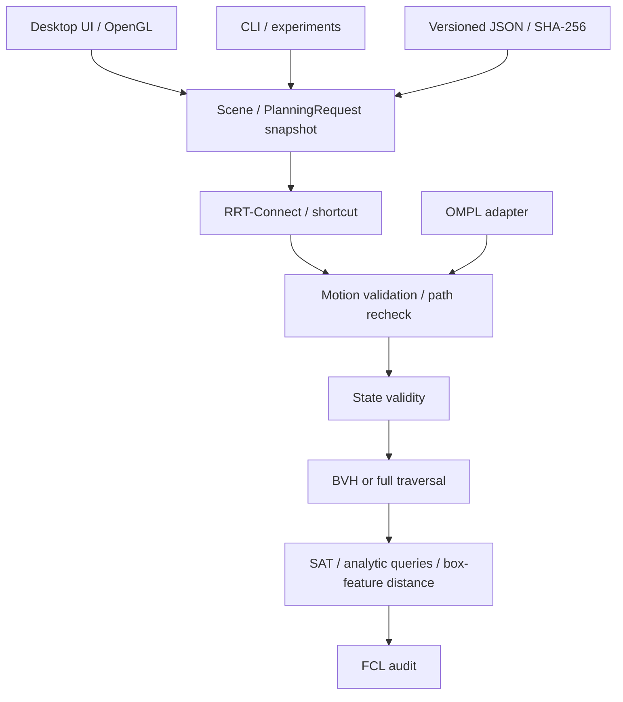

# Architecture

`passagelab` is a C++20 core library. The CLI and desktop link the same planning, geometry and IO implementation. The core has no OpenGL, GLFW or ImGui dependency.

`Scene` stores immutable-by-convention local components, fixed obstacles, sampling and physical bounds, endpoints, configuration and revision. `Validator` owns its own scene copy, obstacle index and query counters. It does not retain pointers to UI-owned vectors. Planner trees own nodes and refer to parents by index.

The desktop's worker receives a scene snapshot. A request ID prevents a cancelled or stale worker from publishing into a newer scene. Edits update revision/hash and invalidate results. OpenGL calls remain on the UI thread. Progress and completed results cross an explicit synchronization boundary.

FCL and OMPL types remain within their implementation files. FCL audits separated OBB distance queries and provides independent collision tests. SAT classifies collision; a box-specific feature distance supplies authoritative separated distance/witnesses. OMPL is a comparison planner, not the source of the self-written planner's paths.

The content hash is SHA-256 of canonical JSON computation inputs, excluding the hash itself and revision number. The current Windows implementation uses CNG. Loading a scene recomputes its hash. Loading a path grants no validity; endpoint, metadata and full motion checks must run again.
