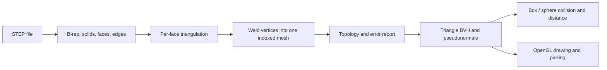

# CAD to triangle mesh

Work after the 0.2.0 release. A STEP file can be used as a fixed obstacle: the B-rep is tessellated, assembled into one indexed triangle mesh, checked, and queried through a triangle BVH. The moving body is still made of boxes and spheres.

## Pipeline



1. **Read.** OpenCASCADE's STEP reader translates the file into a B-rep. The model is read in millimetres and multiplied by `scale` (default 0.001) to reach scene metres. The file is passed as a stream, so paths outside the ANSI code page work.
2. **Tessellate.** `BRepMesh_IncrementalMesh` triangulates every face. `linear_deflection` is the maximum chordal distance between a triangle and the surface, in scene units; `angular_deflection` limits the angle between neighbouring segments. Whichever is stricter for a given curvature decides the density: a 40 mm fillet at the default 0.35 rad is already finer than a 1 mm chordal limit, so only the angular value changes it.
3. **Assemble.** The kernel returns one node set per face. PassageLab applies each face's location, flips the winding of reversed faces so normals point out of the material, and concatenates the faces into a triangle soup that keeps the source face index of every triangle.
4. **Weld.** Vertices on a shared edge appear once per adjacent face. A uniform grid with cells of twice the tolerance merges vertices closer than `max(1e-9, 1e-10 * diagonal)` metres and drops triangles that collapse. The tolerance is far below any deflection, so it reconnects faces without changing the shape.
5. **Check.** `analyze` counts degenerate and duplicate triangles, boundary edges (used once), non-manifold edges (used more than twice), inconsistently oriented edges and connected components, and integrates area and signed volume. Both are compared with the area and volume the kernel integrates on the exact B-rep.

The tessellation algorithm itself is OpenCASCADE's. PassageLab's own code starts at step 3: assembly, welding, checking, the BVH and the queries.

## Solid or surface

A mesh that is closed (every edge shared by exactly two triangles), consistently oriented and of non-zero volume is a **solid**. A body completely inside it overlaps, although it touches no triangle. Any other mesh is a **surface**, and only contact with a triangle counts. The scene file and the viewer state which case applies.

Inside/outside for a solid uses the sign of the offset from the closest point against the pseudonormal of the closest feature: the face normal, the sum of the two face normals on an edge, or the angle-weighted normal at a vertex (Bærentzen and Aanæs). It costs nothing beyond the closest-point query. The generalized winding number is linear in the triangle count and is kept as an independent audit used by the tests.

## Queries

Triangles are never transformed. The body part is moved into the mesh frame, which preserves distances, and witness points are moved back.

- **Sphere.** Branch-and-bound closest point over the BVH, nearer child first, pruning nodes whose box is farther than the current best.
- **Box.** For each candidate triangle, a 13-axis separating-axis test (three box normals, the triangle normal, nine edge cross products) classifies overlap, contact or separation. For separated pairs the distance is the minimum over triangle vertices against the box, box vertices against the triangle, and the 3-by-12 edge pairs; for a separated box and triangle one of these feature pairs attains the minimum. The traversal is ordered by box-to-node distance and stops refining once every remaining node is farther than the best exact distance.
- **Ray.** Slab test against nodes, nearest hit over triangles; used for picking in the viewer.

The BVH is a median split on triangle centroids with at most four triangles per leaf. Every query can also run without it, and the two must agree.

## Scene format

```json
{ "id": "wall-step", "shape": "mesh", "pose": { "position": [0,0,0], "quaternion": [0,0,0,1] },
  "source": { "format": "step", "file": "plate-with-hole.step",
              "linear_deflection": 0.001, "angular_deflection": 0.35, "scale": 0.001 } }
```

`file` is relative to the scene file. Loading always rebuilds the triangles from the CAD file. The scene hash covers the tessellation settings and a SHA-256 of the resulting vertices and indices, but not the file location: a different deflection is a different scene, so a path validated against one tessellation is rejected against another. Existing box/sphere scenes keep their hashes.

## Commands

```powershell
$cli = './build/windows/Release/passagelab_cli.exe'
& $cli cad-sample --part plate-with-hole --out assets/cad/plate-with-hole.step
& $cli cad-mesh --cad assets/cad/plate-with-hole.step --deflection 0.001 --out results/plate.json
& $cli cad-mesh --cad results/torus.step --sweep --out results/torus-sweep.json
& $cli mesh-benchmark --cad results/torus.step --deflection 0.0005 --out results/torus-benchmark.json
& $cli plan --scene assets/cad/D-step-aperture.json --seconds 0 --out results/step-aperture
```

`cad-mesh` exits with 2 when any tessellation is not watertight. `cad-sample` writes analytic parts (`cylinder`, `sphere`, `torus`, `filleted-block`, `plate-with-hole`) built with the same kernel; they exist so the tests and benchmarks need no external model.

In the viewer, a mesh obstacle shows its triangle count and solid/surface state. Editing **Deflection (mm)** re-tessellates from the CAD file and invalidates the current result. **Wireframe** shows the triangulation.

## Measurements

Windows x64, MSVC Release, OpenCASCADE 8.0.1, base commit `89649c6` with the uncommitted changes described here. Raw output: [worktree-mesh](../benchmarks/data/worktree-mesh/).

Torus (major radius 0.5 m, minor 0.15 m), angular deflection 0.35 rad:

| Linear deflection | Triangles | Vertices before → after weld | Watertight | Volume error | Area error |
|---|---|---|---|---|---|
| 16 mm | 2,592 | 1,369 → 1,296 | yes | 1.01% | 0.44% |
| 4 mm | 2,952 | 1,554 → 1,476 | yes | 0.90% | 0.37% |
| 2 mm | 4,104 | 2,146 → 2,052 | yes | 0.71% | 0.25% |
| 1 mm | 6,318 | 3,280 → 3,159 | yes | 0.53% | 0.17% |
| 0.5 mm | 12,540 | 6,440 → 6,270 | yes | 0.27% | 0.09% |

Errors are relative to the kernel's B-rep integrals. The 16 mm and 8 mm rows are identical because the angular limit governs there.

1,000 fixed poses against the 12,540-triangle torus, BVH against testing every triangle:

| Body | Triangle tests, all | Triangle tests, BVH | Reduction | Time, all | Time, BVH | Results agree |
|---|---|---|---|---|---|---|
| Box | 24,122,947 | 239,070 | 99.0% | 9.39 s | 0.137 s | 1,000 / 1,000 |
| Sphere | 12,540,000 | 86,430 | 99.3% | 0.184 s | 0.0047 s | 1,000 / 1,000 |

Agreement means the same relation and, when separated, distances within 1e-9 m. The box count without the BVH exceeds 1,000 × 12,540 because separated poses also run the inside test. Times are single runs on one machine and are not a general performance claim.

Scene `D-step-aperture`: a 1.0 m bar must pass a 0.9 m round aperture in a 3 m STEP plate, so it has to align with the hole axis. With seed 42 and a 0.02 step the planner solved it in 142 iterations; the original and shortcut paths both pass a recheck at 0.005.

## Tests

`tests/test_mesh.cpp` adds six cases (46 CTest cases in total):

- welding a per-face cube restores 8 vertices, closure and volume; removed, flipped and duplicated triangles are reported as boundary, inconsistent and non-manifold edges;
- closest-point features on a triangle, including a collinear one;
- a meshed box against the analytic box queries on the same geometry: relation, distance and witness points over random poses of a box and a sphere body;
- every sample part is one closed, outward-oriented component at two deflections, finer settings give more triangles and a smaller volume error, and kernel volumes match closed forms;
- BVH against exhaustive search for closest point, ray and box/sphere queries on a tessellated torus, mesh distance against the analytic torus distance, and pseudonormal inside against the winding number;
- a STEP obstacle in validation, scene save/load, hashing and planning.

## Limits

- STEP only. No IGES, no assemblies with per-instance colours or names, no healing of invalid B-reps. A face the kernel cannot triangulate is counted in `untriangulated_faces` and leaves the mesh open, which downgrades it to a surface.
- Mesh parts are obstacles only. A mesh moving body would need triangle-triangle queries.
- The mesh approximates the surface within the deflection. Clearance reported against a mesh can differ from clearance against the exact surface by up to that amount; choose the deflection below the clearance that matters.
- The inside test assumes a closed manifold mesh; self-intersections are not detected.
- Motion validation is still discrete sampling, as described in [validation](validation.md).
