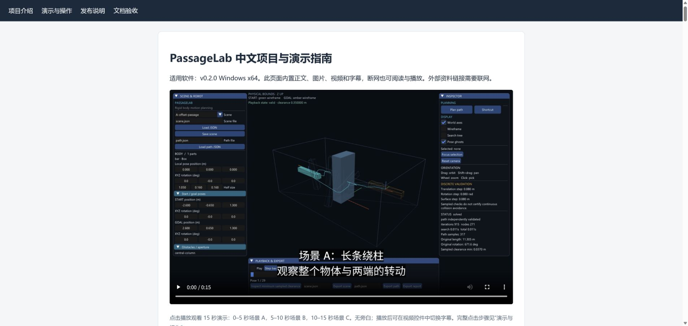

# 中文项目与演示说明验收记录

适用版本：PassageLab v0.2.0。验收范围：中文文档及离线指南。[中文首页](../README.zh-CN.md) · [演示指南](demo.zh-CN.md)

## 首轮验收

| 检查项 | 核对方式与结果 |
|---|---|
| 下载与启动 | 首页区分便携 ZIP、源码和中文文档补充包；明确完整解压、启动脚本和英文界面现状 |
| 项目范围 | 单刚体、静态环境、平移/旋转和三场景与源码及设计一致 |
| 名词与操作 | 解释位姿、SE(3)、RRT-Connect、SAT、BVH、JSON；控件保留可在英文界面定位的名称 |
| 单位与几何 | 核对半尺寸/全尺寸、米、度/弧度、局部/世界坐标；开口由相关箱体围成 |
| 播放与检查 | 说明路径进度不是时间/等弧长；单步为进度 ±0.02；搜索边检查与最终路径分开 |
| 导入与导出 | 核对导入预览必须重验、两个路径输入框独立、报告固定写入 `report.json`；GUI 覆盖与 CLI 拒绝覆盖明确区分 |
| 命令行示例 | 使用已发布软件包的 CLI：A/B/C 三次求解、C 两次精细复核、零预算示例、OMPL B 对照均符合预期 |
| 平面限制 | 用原始 C 实测得到 `invalid_goal`，与文档解释一致；正式公平对照另用兼容共同端点 |
| 桌面控件流程 | 使用发布包对 A/B/C 各执行 25 项真实控件输入回放，75 项均通过（复验） |
| 数据一致性 | 核对原始汇总：690=360+330，640 成功、50 预算耗尽；窄开口 12/30、共同端点 SE(3) 30/30、平面 0/30 |
| 视频说明 | 对照录制配置和视频：A/B/C 各 60 帧、12 fps，每场景 5 秒；说明视频无旁白、只展示播放；新增中文字幕 |
| 边界与来源 | 保留离散检查、预算耗尽、采样间隙、参考运动不喂给规划器、FCL 审计与共享验证器的限制 |

## 首轮页面与交付检查

- 四份中文正文的 27 个本地 Markdown 引用逐一检查，目标均存在；中文 UTF-8 无替换字符。
- Chrome 本机 HTTP 预览中，中文、表格和四张原有演示图片正常显示；当前 1920 像素宽视口无整页横向溢出。四个章节目标均存在，点击“演示与操作”已正确跳转。
- 内置视频实际时长 15 秒，可正常播放；中文字幕轨加载成功，已观察到字幕显示。三段字幕与 A/B/C 各 5 秒的录制时序一致。
- 离线 HTML 的图片、视频、CSS 和字幕全部内置，无外部渲染资源依赖；在线参考资料仍需要网络。ZIP 完整性和独立 SHA-256 校验文件均检查。
- 浏览器检查使用本机 HTTP 预览，未验证 `file://` 模式。
- 原软件 ZIP 的 SHA-256 与原验收记录一致；生产源码未修改。新增中文文档 ZIP 是独立附件，不替换原软件包。

程序测试与文档验收分别记录。运行输出： `results/chinese-docs-acceptance/`；摘要： `benchmarks/data/worktree-0.2.0/chinese-docs-review.json`。原软件包与生产源码指纹保持不变。
