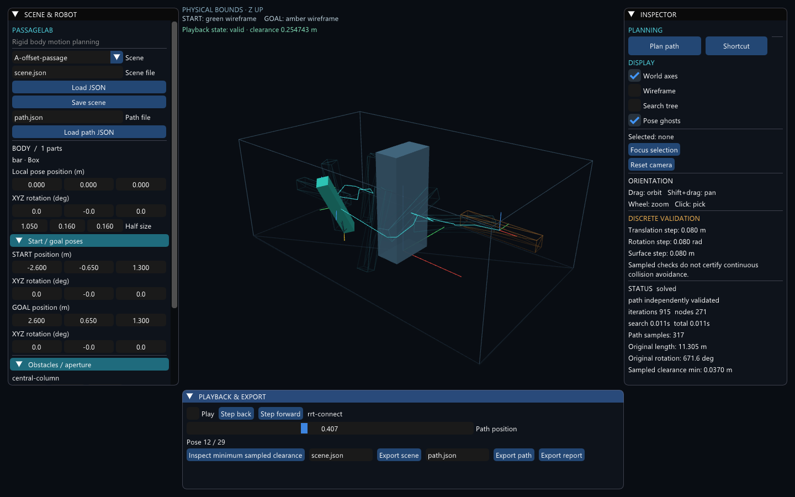
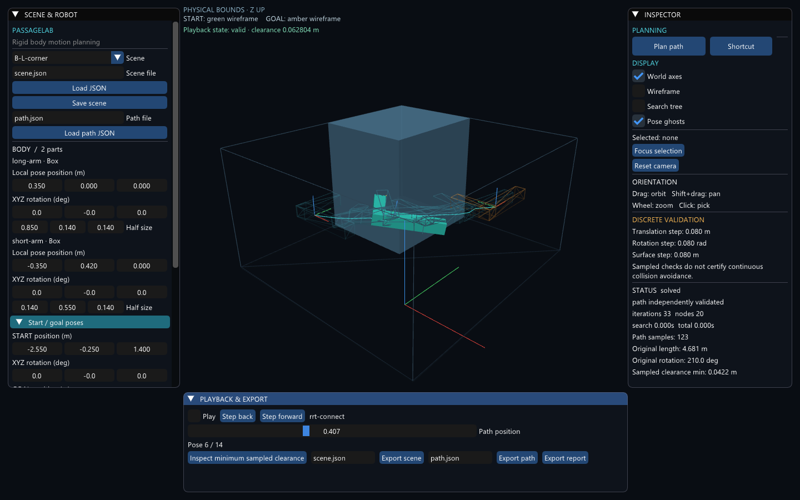
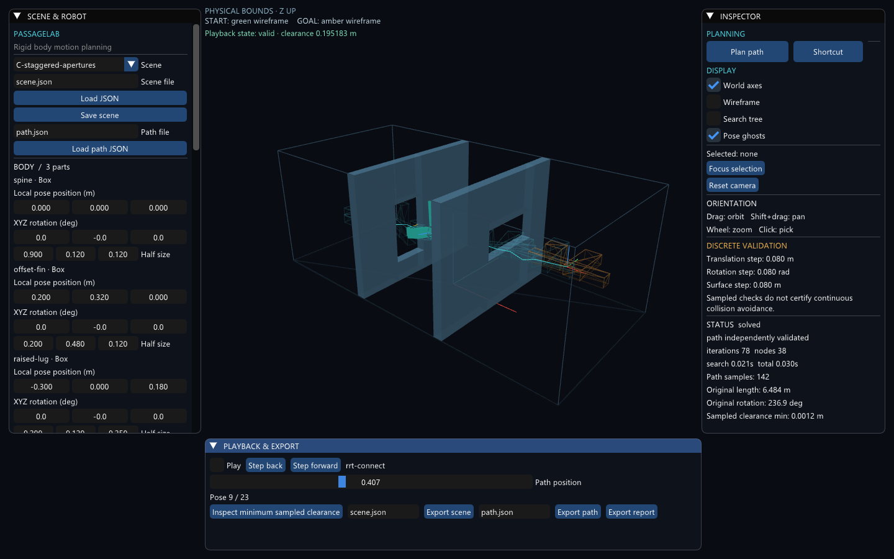

# PassageLab 中文演示与操作指南

[返回中文项目介绍](../README.zh-CN.md) · [English viewer guide](viewer.md) · [中文发布说明](releases/v0.2.0.zh-CN.md)

适用版本：**v0.2.0 Windows x64**。控件名称标注为“`英文名称`（中文含义）”。

## 1. 启动与窗口布局

从 [发布页](https://github.com/CG-Yici/PassageLab/releases/tag/v0.2.0) 下载 `PassageLab-0.2.0-windows-x64.zip`，完整解压到有写入权限的目录，运行 `Start PassageLab.cmd`。窗口打开时默认是场景 A，尚未自动开始规划。



| 位置 / 英文标题 | 中文用途 |
|---|---|
| 左侧 `SCENE & ROBOT` | 选择场景、读写文件、编辑刚体尺寸/位姿和规划参数 |
| 中间三维视图 | 看物体、障碍、起终位姿和路径；上方有当前状态、物理边界与坐标提示 |
| 右侧 `INSPECTOR` | 检查器：开始/取消规划、显示选项、结果状态及指标 |
| 下方 `PLAYBACK & EXPORT` | 播放、原始/简化切换、最小采样间隙定位、导出 |

看不到左侧的某个分组时，把鼠标移入左侧面板后滚动；`Planner & validation`（规划与验证）默认折叠，点标题展开。切换场景后若视角不合适，点击 `Reset camera`（重置相机）。

视图中绿色线框表示起点，琥珀色线框表示终点，青绿色通常表示当前物体，蓝灰色表示障碍。选中对象也会改变颜色；**不要仅凭颜色判断碰撞**，应同时看状态文字和被指出的对象。`PHYSICAL BOUNDS · Z UP` 表示有物理边界，Z 轴向上。

## 2. 场景 A：规划与播放

1. 在左上角 `Scene`（场景）中选择 **`A-offset-passage`**。展开 `Planner & validation`，确认 `Seed`（种子）为 **42**，`Planar XY (fixed Z / yaw only)` 未勾选。初次演示保持其他内置设置。
2. 点击右侧 **`Plan path`（规划路径）**。它启动后台搜索；运行时可点击 `Cancel`（取消）。等右侧 `STATUS` 显示 **`solved`**，即完整路径通过本次离散检查。其他状态见第 7 节。
3. 勾选下方 **`Play`（播放）**，再取消勾选暂停。拖动 `Path position`（路径位置）从 0 到 1 看全过程。0 对应起点，1 对应终点；这是路径插值进度，不是秒数，也不是严格等弧长进度。`Step back` / `Step forward` 每次将进度减/加 0.02，不是跳到相邻保存节点。
4. 留意长条的两端如何绕过中央柱体。点击 **`Inspect minimum sampled clearance`（定位最小采样间隙）**，程序暂停并跳到已计算的最小间隙位置。这个最小值只覆盖采样点，不能代表连续运动中所有时刻的最小间隙。
5. 点击右侧 **`Shortcut`（简化路径）**，等待完成。下方出现 **`Show optimized`（显示简化路径）**，点击后可通过 **`Show original`（显示原始路径）** 切回。比较右侧原始/简化长度、累计转角和采样间隙；没有明显变短也不等于错误，算法可能没有找到更好的已验证替换段。
6. 按第 5 节导出场景、当前显示的路径和报告，再重新加载并验证。

## 3. 场景 B、C 与演示视频

### B：L 形组合体转弯

在 `Scene` 选择 **`B-L-corner`**，点击 `Reset camera`，再 `Plan path` → `Play`。两个箱体固定连接成 L 形，移动中相对位置不变。观察转角时长臂和短臂各自的空间占用。



### C：不对称组合体穿过错位开口

选择 **`C-staggered-apertures`**，重置相机并重新规划。三个部件形成不对称刚体，两道墙上的开口形状和中心位置不同。播放时观察高度、朝向和侧向位置的配合。被墙挡住时可打开 `Wireframe`（线框）或旋转视角。



原始 C 起点高度 1.05 m、终点高度 1.55 m，初始倾斜也与终点不同，勾选平面模式会得到 `invalid_goal`。公平对照使用单独记录的共同端点变体：两端高度均为 1.55 m、朝向均为单位四元数，之后只改变运动空间。实测 SE(3) 30/30、平面 0/30，仍不证明平面无解。

### 演示视频

[15 秒视频](https://github.com/CG-Yici/PassageLab/releases/download/v0.2.0/passagelab-demo.mp4)按 A → B → C 顺序展示路径播放，无旁白。

| 视频时间 | 对应内容 | 中文说明 |
|---|---|---|
| 00:00–00:05 | A：长条绕柱 | 注意整体外形和两端的转动，不能只检查中心点 |
| 00:05–00:10 | B：L 形转角 | 两个部件始终是同一刚体，整体绕转角移动 |
| 00:10–00:15 | C：错位开口 | 不对称组合体同时调整位置、高度与三维朝向 |

录制每场景 60 帧、编码为每秒 12 帧，播放速度是演示设置，不代表真实物体速度。仓库提供 [中文字幕 SRT](media/0.2.0/passagelab-demo.zh-CN.srt)；支持外挂字幕的播放器可手动加载。离线中文指南已内置视频与中文字幕。

## 4. 查看、拾取和编辑

| 操作 / 控件 | 中文含义与注意事项 |
|---|---|
| 在空白视口拖动 | 围绕目标旋转相机；应从物体之外的空白处开始 |
| 按住 Shift 在空白处拖动 | 平移相机 |
| 在视口滚动滚轮 | 放大/缩小视角 |
| 单击物体或障碍 | 拾取对象，右侧 `Selected` 显示选择情况 |
| `Focus selection` / `Reset camera` | 聚焦所选对象 / 重置相机；聚焦移动体使用当前显示位姿 |
| 拖动拾取对象 | 编辑位置，会使旧结果失效；组合部件的位置属于刚体局部坐标，不是“搬动整个规划物体” |
| `World axes` / `Wireframe` / `Pose ghosts` | 世界坐标轴 / 线框 / 沿路径显示的若干姿态残影 |
| `Search tree` | 搜索树显示；橙色来自起点树，紫色来自终点树，红色表示被拒绝或检查未完成的运动 |
| `Inspect search motion`、`Edge`、`Edge position` | 检查搜索运动段、选择段编号及段内位置；不是在查看最终成功路径 |

关闭 `Inspect search motion`，或点击最小采样间隙按钮，才能回到正常路径检查。树最多显示 4000 条边。

编辑示例：在 A 场景完成规划后，记下 `BODY` 下的 `Half size`，将第二或第三个值从 0.160 小幅改为 0.180。旧结果应立即失效，并显示 `Inputs changed - previous result invalidated. Plan again.`（输入改变，旧结果失效，请重新规划）。再点 `Plan path`，新结果才属于新几何。重新选择内置场景可恢复默认参数。

| 编辑字段 | 中文含义 / 单位 |
|---|---|
| `BODY`、`Local pose` | 移动刚体部件、部件相对整体的局部位姿 |
| `Half size` | 箱体沿局部 X/Y/Z 的**半尺寸**，单位米；A 的第一项 1.05 代表全长 2.10 m |
| `Radius` | 球半径，单位米 |
| `Start / goal poses`、`START`、`GOAL` | 起终位姿；位置以米计 |
| `XYZ rotation (deg)` | 位姿编辑的角度，以**度**计；文件中的朝向采用四元数 `[x,y,z,w]`，不是三个欧拉角 |
| `Obstacles / aperture`、`Obstacle pose` | 障碍/开口区域的箱体及其位姿。开口由周围箱体围成；修改开口需协调相关箱体位置和半尺寸 |
| `Planner & validation` | 规划与检查参数分组；任何计算参数变化也会使旧结果失效 |
| `Planar XY (fixed Z / yaw only)` | 固定起点高度和初始倾斜，仅允许 XY 平移和绕世界 Z 轴旋转；终点必须兼容 |
| `Iteration budget`、`Time limit (s, 0 = none)` | 操作次数预算、时间预算（秒）；时间填 0 只关闭时间限制，其他预算仍有效 |
| `Seed`、`Shortcut attempts` | 随机种子、简化尝试次数 |
| `Extension (m)`、`Rotation weight` | 一次扩展的加权位姿距离尺度、旋转权重；Extension 不是单纯的平移米数 |
| `Goal bias` | 选择目标方向作为采样目标的概率；0 不表示禁止连接到目标 |
| `Translation step (m)` | 平移检查步长上限，米 |
| `Rotation step (rad)` | 旋转检查步长上限，**弧度**；0.08 rad 约为 4.58°，不同于位姿编辑的度数 |
| `Surface step (m)` | 基于平移加旋转表面运动估计的细分限制，米；不是障碍间隙 |
| `Margin (m)` | 所要求的额外间隙，米；提高要求可能使原来有效的状态不再有效 |

## 5. 导出、重载与指标解读

先完成一次规划，再进行以下步骤。相对文件路径从程序工作目录解析；通过 `Start PassageLab.cmd` 启动时，工作目录是解压软件包所在目录。

1. 在下方 `Export scene` 左边输入新的场景文件名，例如 `my-a-scene.json`，点击 **`Export scene`（导出场景）**。左侧 `Save scene`（保存场景）使用同一个场景文件路径。
2. 在下方 `Export path` 左边输入 `my-a-path.json`，点击 **`Export path`（导出路径）**。导出的是当前显示的原始或简化路径；若想都保留，切换显示后分别使用不同文件名导出。
3. 点击 **`Export report`（导出报告）**。v0.2.0 GUI 将报告写入工作目录的 **`report.json`**，没有报告文件名输入框。再次导出会覆盖同名文件；保存重要结果时先复制或重命名旧报告。GUI 场景/路径导出也会覆盖同名文件。
4. 重载时，先在左侧 `Scene file` 填 `my-a-scene.json` 并点击 **`Load JSON`（加载场景）**；再在左侧 `Path file` 填 `my-a-path.json` 并点击 **`Load path JSON`（加载路径）**。左侧路径输入框与下方导出路径输入框是两个独立字段。
5. 此时路径只作为 **`IMPORTED PREVIEW · UNVERIFIED`（导入预览，未验证）** 展示。点击下方 **`Revalidate path`（重新验证路径）**，等待验证结果。`STALE / UNVERIFIED` 表示元数据与当前场景不匹配且未验证，应恢复对应场景或重新规划。

| 结果字段 | 正确读法 |
|---|---|
| `Original length` / `Optimized length` | 原始/简化路径的累计平移长度，米 |
| `Original rotation` / `Optimized rotation` | 界面中的累计转角，度；JSON 的 `rotation_rad` 用弧度 |
| `Sampled clearance min` / `Optimized clearance` | 原始/简化路径采样到的最小间隙；不是连续间隙下界 |
| `Path samples` | 路径指标评估使用的采样数量，不是所有搜索查询的总数 |
| `search` / `total` | 搜索耗时 / 规划器总耗时（搜索及最终验证等）；不包含随后单独计时的指标评估和 shortcut 全部成本 |
| `iterations` / `nodes` | 搜索扩展计数 / 树节点数，不是帧数 |
| `DISCRETE VALIDATION` | 本次离散验证的步长声明，不能读成连续安全证明 |

报告 JSON 记录场景指纹、种子、参数、原始/简化指标和来源。`source_sha256` 为生产源码指纹，`scene_hash` 为场景输入指纹。恢复会话需加载场景和路径，再重新验证；报告用于查看记录。

## 6. 命令行演示

以下命令用于**解压后的便携包目录**。在该文件夹打开 PowerShell，先确认能看到 `passagelab_cli.exe`。每次重跑请把 `runs/a` 等改成新的目录名，CLI 不会覆盖已有运行文件。

```powershell
./passagelab_cli.exe plan --demo 0 --seed 42 --seconds 0 --out runs/a
./passagelab_cli.exe plan --demo 1 --seed 42 --seconds 0 --out runs/b
./passagelab_cli.exe plan --demo 2 --seed 42 --seconds 0 --out runs/c
./passagelab_cli.exe validate-path --scene runs/c/scene.json --path runs/c/path.json --step 0.02 --out runs/c/path-fine.json
./passagelab_cli.exe validate-path --scene runs/c/scene.json --path runs/c/optimized.json --step 0.02 --out runs/c/optimized-fine.json
```

`--demo 0/1/2` 对应 A/B/C；`--seconds 0` 保留操作预算，关闭时间截止。CLI 的 `plan` 默认也尝试 shortcut：成功后通常得到 `scene.json`（此次实际配置）、`path.json`（原始路径）、`optimized.json`（简化结果）和 `report.json`（报告）。复核时使用同次导出的 `scene.json`，不能随意换成另一个默认场景文件。`--step 0.02` 同时设置平移 0.02 m、旋转 0.02 rad 和表面运动 0.02 m 三个限制。

`validate-path` 输出中的数值 `status: 0` 表示检查通过；1、2、3 分别表示失败、检查未完成、取消。这是检查状态编码，不是规划报告里的 `solved` 等字符串，也不要与进程退出码混淆。

确定性的预算耗尽演示：

```powershell
./passagelab_cli.exe plan --demo 2 --iterations 0 --out runs/budget-zero
```

预期返回 `budget_exhausted`，进程退出码为 **2**；目录有场景和报告，没有成功路径。`plan` 的退出码 0 表示已求解并验证，1 表示输入/执行错误，2 表示已记录的未求解结果。

OMPL 对照可以使用 `plan --demo 1 --planner ompl --seed 42 --out runs/ompl-b`；完整命令前加同样的 `./passagelab_cli.exe`。批量实验脚本位于源码仓库。

## 7. 状态和常见问题

| 看到的英文 / 情况 | 中文含义与处理 |
|---|---|
| `solved` | 完整路径已通过声明的离散检查；可以播放、比较和导出 |
| `invalid_start` / `invalid_goal` | 起点/终点无效：检查碰撞、边界、间隙要求及平面模式兼容性 |
| `budget_exhausted` | 时间、操作、节点或查询预算不足；保留报告，调整预算或场景再试，不宣称无解 |
| `cancelled` | 用户或应用请求取消 |
| `validation_incomplete` | 候选路径检查未完成或存在不确定情况，不得按成功路径使用 |
| `error` | 配置或执行错误；查看 `reason` 或界面提示 |
| `Playback state: valid` | 当前显示位姿通过检查，不代表单凭这一帧就验证了整条路径 |
| `Playback state: collision / uncertain` | 当前位姿碰撞或检查结果不确定 |
| `Inputs changed - previous result invalidated. Plan again.` | 输入改变后旧结果失效；需要重新规划 |
| `Output already contains run artifacts` | CLI 输出目录已有数据，换新的 `--out` 目录 |
| `Cannot open ...` | 文件不存在或路径不对；检查工作目录和具体文件名 |
| 找不到 DLL / 窗口打不开 | 先完整解压并保留 DLL 与程序同目录，确认 OpenGL 3.3 驱动；不要从任意网站下载单独 DLL |
| 窗口打开但无路径 | 刚启动只有场景，先点击 `Plan path` 并检查 `STATUS` |
| 点击最小间隙按钮找不到它 | 它只在路径已验证且指标计算完整等条件满足时出现；未验证导入路径要先重新验证 |
| 切换播放进度但仍停在搜索姿态 | 取消 `Inspect search motion`，退出搜索边检查 |
| 参数/按钮看不到 | 滚动对应面板、展开分组；尽量使用接近截图的 1440×900 窗口，其他 DPI 未穷尽验证 |

[文档验收记录](chinese-docs-review.zh-CN.md)
