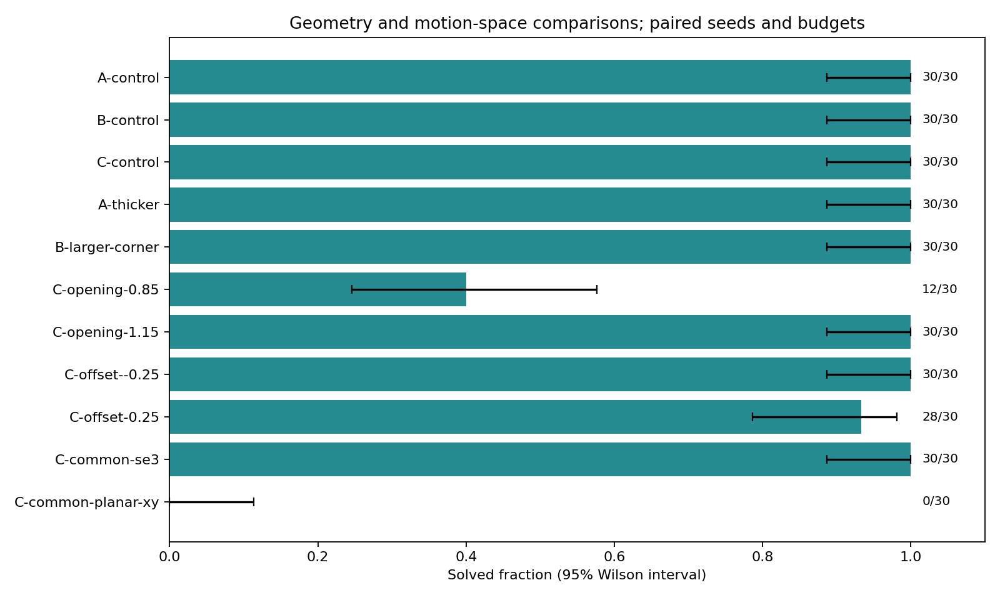

# Experiments

The release experiment configuration is `benchmarks/configs/release.json`. Runs are headless Release builds. Each run exports its exact scene/configuration, path if solved, simplified path if available and report. Reference motions never seed the planner.

The baseline and comparison runner uses 30 predeclared seeds starting at 1000. Comparisons change full traversal versus BVH, 0.08 versus 0.04 sampling steps, or planner implementation. The raw scene hashes differ when computation parameters change; geometric content remains fixed for each comparison.

Report both success fraction (with 95% Wilson interval) and timing conditional on success. Preserve every failed run and status. A time budget depends on hardware and scheduling; fixed operation budgets are used for deterministic regression cases. Repeated configurations must not silently replace difficult cases with easier geometry.

Timing includes the phases indicated by each field. Search, final verification, clearance evaluation and shortcut are separate costs. No GPU performance claims are made from headless data. Small scene obstacle counts may provide little or no speedup from a BVH; conclusions must follow measurements.

## Executed worktree verification: 0.2.0

Release x64, MSVC 19.37, Windows build 26200, 32 logical processors and 64 GiB physical memory. All **690** reports use production-source SHA-256 `55ddafaf7c410f5e2916476d46028f25f24c5d64a3368fabd67875a5f1486789`. Every configuration used seeds 1000–1029 and goal bias zero. No reference path seeded a planner. Runs were headless and were not overlapped with builds or UI benchmarks.

The 360 standard runs all solved: three scenes × 30 seeds × four configurations. Median search-plus-final-verification seconds (conditional on success):

| Configuration | A | B | C |
|---|---:|---:|---:|
| Self / BVH / 0.08 | 0.002898 | 0.000400 | 0.037694 |
| Self / full traversal / 0.08 | 0.009646 | 0.003739 | 0.061762 |
| Self / BVH / 0.04 | 0.004526 | 0.000630 | 0.069549 |
| OMPL / BVH / 0.08 | 0.003755 | 0.000610 | 0.033285 |

The standard search limit was five seconds. Reports also preserve search-only minimum, quartiles, median and maximum, as well as separate evaluation/optimization costs. A 30/30 result has a 95% Wilson interval of [0.8865, 1.0]. Small timings are host/scheduling dependent; this is not a universal planner ranking. OMPL and self-written planning have distinct RNG streams and operation accounting.

All 360 solved paths had complete metrics and non-increasing shortcut objectives. Baseline median objective before → after shortcut (translation + rotation_weight × rotation):

| Scene | Original | Shortcut |
|---|---:|---:|
| A | 17.476 | 11.396 |
| B | 9.722 | 7.277 |
| C | 12.802 | 9.164 |

This objective does not maximize clearance; clearance and translation/rotation metrics remain separately available.

### Geometry and planar restrictions

A further **330** runs used a one-second search limit, including unchanged A/B/C controls at the same budget. Each geometry variant changes one factor: bar cross-section ×1.25, inner-corner size ×1.15 with outer faces fixed, both opening dimensions ×0.85/1.15, or the second opening's Y center offset by ±0.25 m. Physical outer walls stay fixed. Compare these variants to the one-second controls, not directly to the five-second timing table.

The common-endpoint C pair uses identical geometry and endpoints in both modes (Z=1.55 m, identity start/goal orientation). It is a separately recorded scenario; original C endpoints were not silently projected. Only motion-space restriction changes within this pair.

| Configuration | Solved | Budget exhausted | 95% Wilson interval |
|---|---:|---:|---:|
| A-control | 30/30 | 0 | [0.886, 1.000] |
| B-control | 30/30 | 0 | [0.886, 1.000] |
| C-control | 30/30 | 0 | [0.886, 1.000] |
| A-thicker | 30/30 | 0 | [0.886, 1.000] |
| B-larger-corner | 30/30 | 0 | [0.886, 1.000] |
| C-opening-0.85 | 12/30 | 18 | [0.246, 0.577] |
| C-opening-1.15 | 30/30 | 0 | [0.886, 1.000] |
| C-offset--0.25 | 30/30 | 0 | [0.886, 1.000] |
| C-offset-0.25 | 28/30 | 2 | [0.787, 0.982] |
| C-common-se3 | 30/30 | 0 | [0.886, 1.000] |
| C-common-planar-xy | 0/30 | 30 | [-0.000, 0.114] |

The 50 failed runs across the entire 690-run dataset are all `budget_exhausted`; none is labeled geometrically infeasible. Full SE(3) solved 30/30 common-endpoint runs and planar restriction solved 0/30. This demonstrates a budgeted search-performance difference, not a proof that planar motion is impossible. Existing operation/query ceilings remain active alongside time limits.

The dense query workload checks 1000 poses against 144 obstacles. Full traversal and BVH agreed; narrow queries were 134830 versus 1163, with 0.427016 s versus 0.005147 s on this run. This measures geometry queries, not end-to-end planning speedup. Larger obstacle density is represented by this separate query workload, not a claim of a controlled density sweep across all planners.

Evidence: [audit](../benchmarks/data/worktree-0.2.0/audit.json), [baseline](../benchmarks/data/worktree-0.2.0/baseline/summary.json), [comparisons](../benchmarks/data/worktree-0.2.0/comparisons/summary.json), [geometry/planar](../benchmarks/data/worktree-0.2.0/design/summary.json). Each group includes `runs.json` containing every raw report; geometry groups also include exact variant input JSON. Full per-run scene/path outputs remain in `results/experiments-0.2.0/` and `results/design-0.2.0/`. Reproduction commands are in README and manifests. Representative failed scenes/reports are preserved in `assets/examples/0.2.0/`.

## Executed worktree verification: 0.1.1

On 2026-10-28, Release x64 ran 30 seeds (1000–1029) for each scene/configuration, with a five-second search limit and goal bias zero. All 360 runs solved and completed metric evaluation. This concerns these frozen examples only. The 95% Wilson interval for 30/30 successes is approximately [0.8865, 1.0].

Median search-plus-final-verification seconds, conditional on success:

| Configuration | A | B | C |
|---|---:|---:|---:|
| Self / BVH / 0.08 | 0.002781 | 0.000427 | 0.037472 |
| Self / full traversal / 0.08 | 0.008891 | 0.003633 | 0.063132 |
| Self / BVH / 0.04 | 0.004531 | 0.000669 | 0.069172 |
| OMPL / BVH / 0.08 | 0.003779 | 0.000589 | 0.032393 |

These small timings depend on hardware and scheduling. They exclude clearance evaluation and shortcut costs, which are recorded separately. OMPL has distinct RNG and operation accounting; matching seeds do not imply matching samples. No universal planner ranking follows from this table.

The dense-query case checked 1000 poses against 144 obstacles: full traversal made 134830 narrow queries and BVH made 1163, with matching validity and separated distances. Times were 0.431735 s and 0.005228 s respectively. This is a query workload, not an end-to-end planning speedup.

Evidence: [baseline](../benchmarks/data/worktree-0.1.1/baseline/summary.json), [comparisons](../benchmarks/data/worktree-0.1.1/comparisons/summary.json), [query benchmark](../benchmarks/data/worktree-0.1.1/verification/query-benchmark.json). Each configuration includes every full report in `runs.json`, with hardware, parameters, source fingerprint and dependencies. Per-run scenes/paths remain in `results/experiments-0.1.1/` and can be regenerated using recorded seeds and tools. Historical 0.1.0 evidence is preserved separately.
